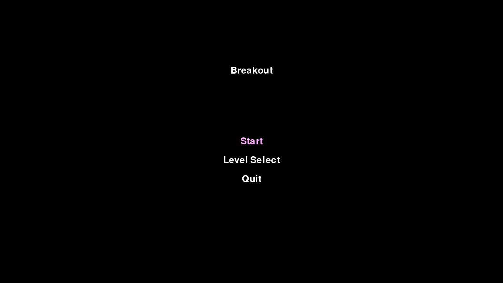
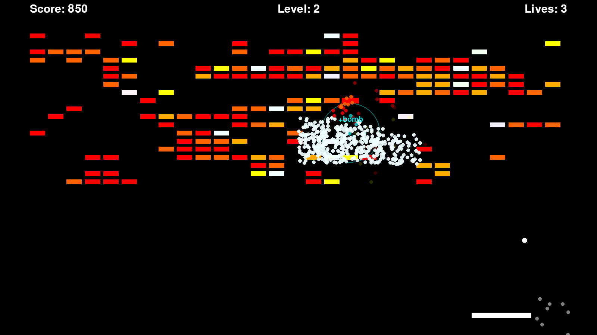
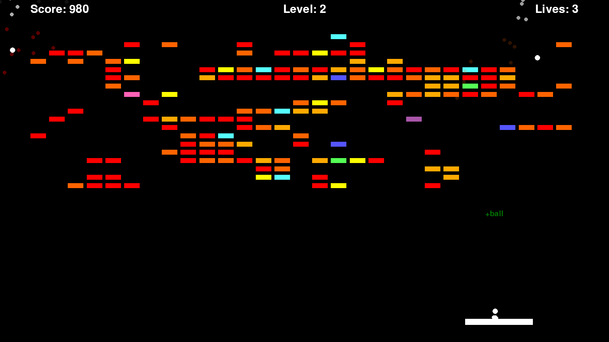
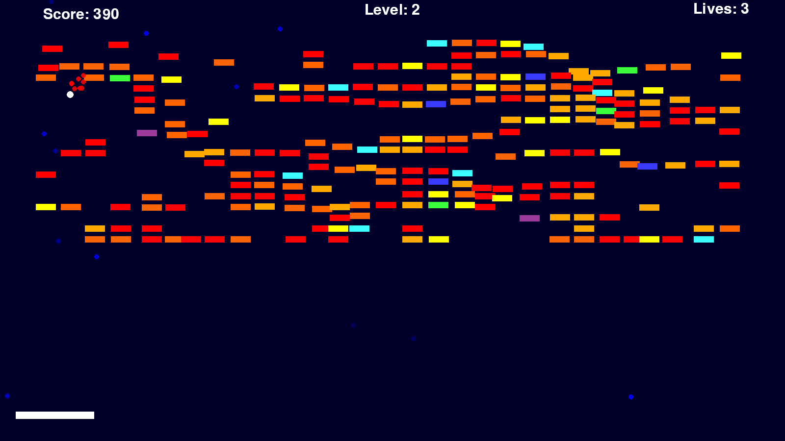
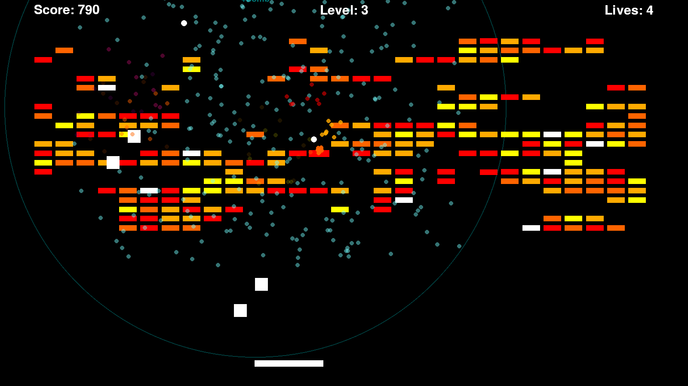

# Breakout

A fullscreen Pygame version of Breakout with procedural brick layouts, multi-hit bricks, particle effects, level selection, and power-ups.

## Requirements

- Python 3
- Pygame

Install Pygame if it is not already available:

```bash
pip install pygame
```

## Running the Game

From this folder, run:

```bash
python3 breakout.py
```

The game opens in fullscreen at the resolution of the largest connected display (by pixel area) reported by Pygame. This is not always the primary monitor.

## Controls

| Action | Control |
| --- | --- |
| Move paddle left | Left arrow |
| Move paddle right | Right arrow |
| Launch ball | Space |
| Pause | `P` or `Esc` |
| Navigate menus | Up/down arrows or mouse |
| Select menu option | Enter or left mouse click |

## How It Works

The goal is to clear every brick on the screen by keeping the ball in play with the paddle. When the ball hits a brick, the brick either loses durability or breaks. Broken bricks add to the score and may drop a power-up. If every active ball falls below the screen, one life is lost and a new ball is attached to the paddle.

The lives counter starts at 3. You still get a new ball when the counter reaches 0, so you effectively have four balls. Losing the ball at Lives: 0 ends the game and returns to the title menu. Clearing all bricks advances to the next level, rebuilds the brick field, increases ball speed, and resets temporary paddle expansion effects.

## Menus

- **Title menu:** Start a new game, choose a starting level, or quit.
- **Level select:** Start from levels 1 through 4.
- **Pause menu:** Resume, restart the current level, return to level select, or quit.

When resuming from pause, the game shows a short countdown before play continues.

## Features

- **Procedural brick fields:** Each level generates a new brick layout using randomized noise.
- **Increasing difficulty:** Later levels create more rows, more durable bricks, and faster ball movement.
- **Multi-hit bricks:** Bricks can require one to four hits. Their color changes as durability drops.
- **Power-up bricks:** Flashing bricks indicate special effects or collectible drops. When the ball hits a brick without breaking it, there is a 2% chance that brick turns into a one-hit power-up brick of a random type (bomb included).
- **Multiple balls:** Extra-ball power-ups add another active ball to the playfield.
- **Particle effects:** Wall hits, paddle hits, brick breaks, bombs, and slow time all spawn particles.
- **Fullscreen scaling:** Paddle size and speed, brick size, ball size, fonts, and power-up size and fall speed scale from the detected screen size. Ball speed is a fixed number of pixels per frame and does not scale. Particle movement and the distortion effects are also fixed in pixels.

## Power-Ups

| Power-up | Color | Effect |
| --- | --- | --- |
| Slow time | Blue | Slows active balls and adds a screen distortion effect for about 10 seconds. |
| Extend platform | Purple | Widens the paddle for the next several ball hits. |
| Extra ball | Green | Adds another ball to the current level. |
| Extra life | Pink | Adds one life. |
| Bomb | Cyan | Explodes nearby regular bricks, clears any falling power-ups in the blast area, and creates a ripple effect. |

The first four drop from their brick when it breaks and take effect when the paddle catches them. Bomb never drops as a pickup. It goes off as soon as the ball hits a bomb brick.

Power-up messages briefly float upward when collected or triggered.

## Scoring and Progression

- Breaking a brick awards 10 points.
- Triggering a bomb brick awards 10 points. Bricks destroyed by the blast award nothing.
- The level number increases automatically after all bricks are cleared.
- Ball speed scales upward as levels increase.

## Screenshots


Title menu.


A bomb brick exploding on level 2.


Three balls in play after an extra-ball pickup.


Slow time active, with the blue screen tint.


Power-ups falling on level 3, with the ripple from a bomb.
